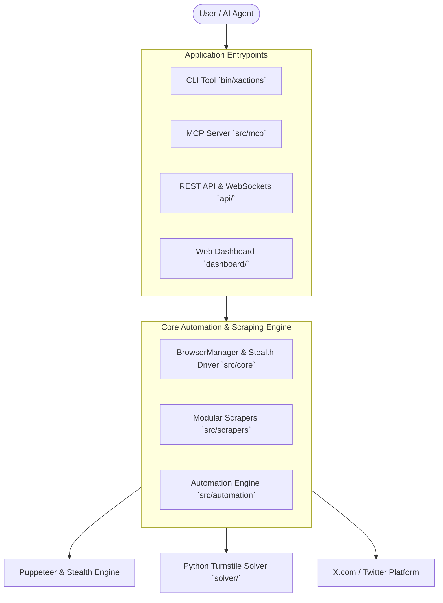

# ⚡ XActions

> **The Complete X / Twitter Automation Toolkit** — Scrapers, MCP Server for AI Agents, CLI, REST API, and Web Dashboard. No API Fees Required.

[](LICENSE)
[](https://www.npmjs.com/package/xactions)
[](https://nodejs.org)
[](https://vitest.dev)
[](https://eslint.org)
[](https://x.com/nichxbt)

🌐 **Website & Dashboard:** [https://xactions.app](https://xactions.app)  
📖 **Legacy Full Docs:** [docs/README_LEGACY.md](docs/README_LEGACY.md)

---

## 🌟 Overview

**XActions** is a modular, high-performance automation suite for X (formerly Twitter) designed to bypass costly API paywalls. It runs directly via browser automation and stealth drivers, enabling full read and write workflows for developers, power users, and autonomous AI agents.

### ✨ Key Features
- 🤖 **MCP Server (25+ Tools):** Native Model Context Protocol support for Claude Desktop, Cursor, and custom LLM agents.
- 💻 **Modern CLI:** Fast, interactive command-line interface with spinners and formatted output.
- 📊 **Modular Scrapers:** No-API scraping for profiles, followers, following, tweets, threads, and media.
- 🚀 **REST API & WebSockets:** Express backend with queue processing, rate limiting, and real-time event streaming.
- 💰 **x402 Micropayments:** Built-in protocol allowing AI agents to pay per call via Base / EVM networks.
- 🖥️ **Web Dashboard:** Clean browser interface for non-technical users.
- 🛡️ **Stealth & Anti-Detection:** Automatic fingerprint protection and optional Turnstile captcha solving.

---

## 🏗️ Architecture



---

## 🚀 Quick Start

### Prerequisites
- **Node.js** `>= 18.0.0`
- **npm** `>= 9.0.0`
- **Python 3.10+** *(Optional: needed for Turnstile captcha solver)*

### Installation

```bash
# Clone the repository
git clone https://github.com/nirholas/xactions.git
cd xactions

# Install dependencies
npm install

# Setup environment variables
cp .env.example .env

# Initialize database schema
npm run db:push
```

---

## 🛠️ Usage Guides

### 1. Library Usage (Node.js ESM)

Import modular scrapers directly into your application:

```javascript
import { BrowserManager, scrapeProfile, scrapeFollowers } from 'xactions';

const manager = new BrowserManager({ headless: true });
const { page } = await manager.launch();

// Scrape profile info
const profile = await scrapeProfile(page, 'elonmusk');
console.log(profile);

// Scrape followers
const followers = await scrapeFollowers(page, 'elonmusk', { limit: 50 });
console.table(followers);

await manager.close();
```

### 2. Command Line Interface (CLI)

Run actions directly from your terminal:

```bash
# Launch interactive CLI
npm run cli

# Bulk scrape tweets
npx xactions scrape tweets --username "elonmusk" --limit 100 --out tweets.json

# Check account suspension status
npx xactions check @username
```

### 3. MCP Server (AI Agents Integration)

Connect XActions to **Claude Desktop**, **Cursor**, or any MCP-compatible client.

#### Claude Desktop Setup (`claude_desktop_config.json`):
```json
{
  "mcpServers": {
    "xactions": {
      "command": "node",
      "args": ["E:/pro/XActions/src/mcp/server.js"],
      "env": {
        "DATABASE_URL": "file:./prisma/dev.db"
      }
    }
  }
}
```

#### Available MCP Tools (25+ Tools):
| Category | Tools |
| :--- | :--- |
| **Auth & Profile** | `x_login`, `x_get_profile` |
| **Scraping** | `x_get_followers`, `x_get_following`, `x_get_non_followers`, `x_get_tweets`, `x_search_tweets`, `x_get_bookmarks`, `x_get_thread`, `x_get_trends` |
| **Actions** | `x_post_tweet`, `x_reply`, `x_quote_tweet`, `x_like`, `x_retweet`, `x_follow`, `x_unfollow`, `x_unfollow_non_followers` |
| **Campaigns & Accounts** | `x_create_campaign`, `x_list_campaigns`, `x_run_campaign`, `x_add_account`, `x_list_accounts` |

### 4. REST API & Web Dashboard

```bash
# Start backend API server
npm run dev

# Start Web Dashboard
npm run dashboard
```
- **API Server:** `http://localhost:5000`
- **Dashboard:** `http://localhost:3000`

---

## 📁 Repository Structure

```plaintext
xactions/
├── api/                    # Express backend, controllers, routes & middleware
│   ├── config/             # Environment & x402 payment configurations
│   ├── middleware/         # Auth, rate limiting & x402 AI monetization
│   ├── routes/             # REST endpoints (auth, operations, AI API)
│   └── server.js           # API entrypoint
├── dashboard/              # Static frontend dashboard and tutorials
├── docs/                   # Detailed architectural and API documentation
│   └── README_LEGACY.md    # Historical extended guide & raw scripts
├── prisma/                 # Prisma ORM schema & seeders
├── scripts/                # Browser console injection scripts & maintenance utilities
├── solver/                 # Python Turnstile & Cloudflare Captcha Solver service
├── src/                    # Core Engine & Modules
│   ├── automation/         # Browser actions & growth automation modules
│   ├── cli/                # Interactive Commander CLI
│   ├── core/               # Unified BrowserManager & DOM selectors
│   ├── mcp/                # MCP Server implementation & tools
│   ├── scrapers/           # Modular domain scrapers (profiles, tweets, auth, export)
│   └── index.js            # Main library entrypoint
└── tests/                  # Unit and integration tests (Vitest)
```

---

## 🧪 Testing & Quality Assurance

```bash
# Run unit and integration test suite
npm test

# Run ESLint validation
npm run lint
```

---

## 🤝 Contributing

Contributions are welcome! Please follow these steps:
1. Fork the project repository.
2. Create your feature branch (`git checkout -b feature/AmazingFeature`).
3. Commit your changes (`git commit -m 'Add AmazingFeature'`).
4. Ensure all tests and linters pass (`npm test && npm run lint`).
5. Push to the branch (`git push origin feature/AmazingFeature`).
6. Open a Pull Request.

Please read [CONTRIBUTING.md](CONTRIBUTING.md) and [CODE_OF_CONDUCT.md](CODE_OF_CONDUCT.md) for details.

---

## 📄 License & Attribution

Distributed under the **MIT License**. See [LICENSE](LICENSE) for more details.

Created and maintained by **nich** ([@nichxbt](https://x.com/nichxbt)).
