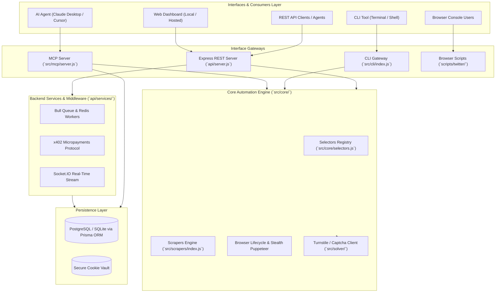

# 🏛️ XActions System Architecture

This document describes the architectural layers, design patterns, and data flows of the **XActions** platform.

---

## 1. Architectural Layers

### 1.1 Core Engine (`src/core/` & `src/scrapers/`)
- **Unified Browser Adapter (`src/core/browser.js`)**: Centralized browser lifecycle manager, session cookie handler, and resilient resource teardown.
- **Selectors Registry (`src/core/selectors.js`)**: Single source of truth for all X/Twitter DOM selectors with fallback handling.
- **Scrapers Engine (`src/scrapers/index.js`)**: Puppeteer-driven scraping logic (Profiles, Followers, Following, Tweets, Bookmarks, Media).
- **Stealth & Anti-Detection**: Emulates real human behavior, custom viewports, randomized delay jitter, and Turnstile bypass.

### 1.2 Interfaces Layer (`src/mcp/`, `src/cli/`, `scripts/twitter/`)
- **MCP Server (25 Tools)**: Model Context Protocol implementation for AI assistants like Claude Desktop, Cursor, and ChatGPT. Supports both `local` (Puppeteer) and `remote` (x402 AI payment protocol) execution.
- **CLI (`src/cli/index.js`)**: Interactive terminal interface with Commander, Chalk, Inquirer, and Ora.
- **Browser Scripts (`scripts/twitter/`)**: 60+ zero-dependency vanilla JS scripts designed for paste-and-run execution directly inside the browser console.

### 1.3 Backend & Services Layer (`api/`)
- **Express Server (`api/server.js`)**: REST API endpoints for multi-account management, campaign automation, and web dashboard integration.
- **Controllers Layer (`api/controllers/`)**: Clean 3-tier separation of HTTP transport from business logic (`scraper.controller.js`, `automation.controller.js`, `admin.controller.js`, `license.controller.js`).
- **Unified Licensing & Telemetry (`api/services/licensing.js`)**: Consolidated license key verification, instance activation, and Prisma database persistence.
- **Job Queue (`api/services/jobQueue.js`)**: Redis/Bull-backed async processing for long-running scrape and automation tasks.
- **x402 Protocol Middleware**: EIP-712 and Base-network micro-payments for AI agent-initiated calls.
- **Prisma ORM (`prisma/`)**: Multi-account credentials, campaign schedules, and execution logs.

---

## 2. Key Design Principles

1. **Zero-API Dependency**: Complete functionality without paying for expensive Twitter/X API subscriptions.
2. **Layered Decoupling**: Separation of UI/API transport from the underlying scraping and automation logic.
3. **Resilient Selectors**: Centralized selectors dictionary prevents DOM changes from breaking multiple entry points.
4. **Safety & Rate Limiting**: Intelligent delays (1-3s jitter) and backoff strategies to protect accounts from shadowbans.
